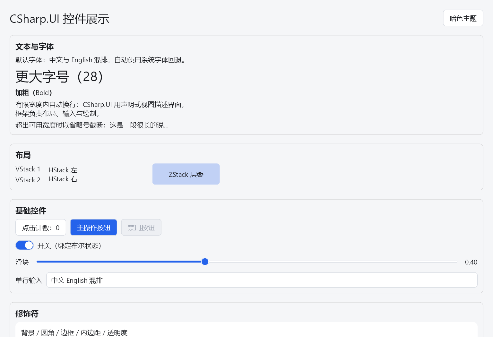
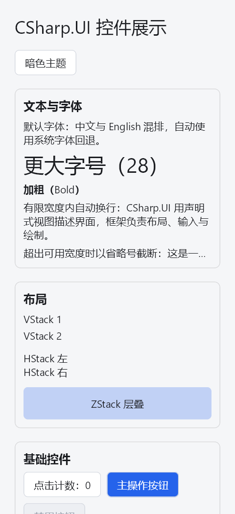
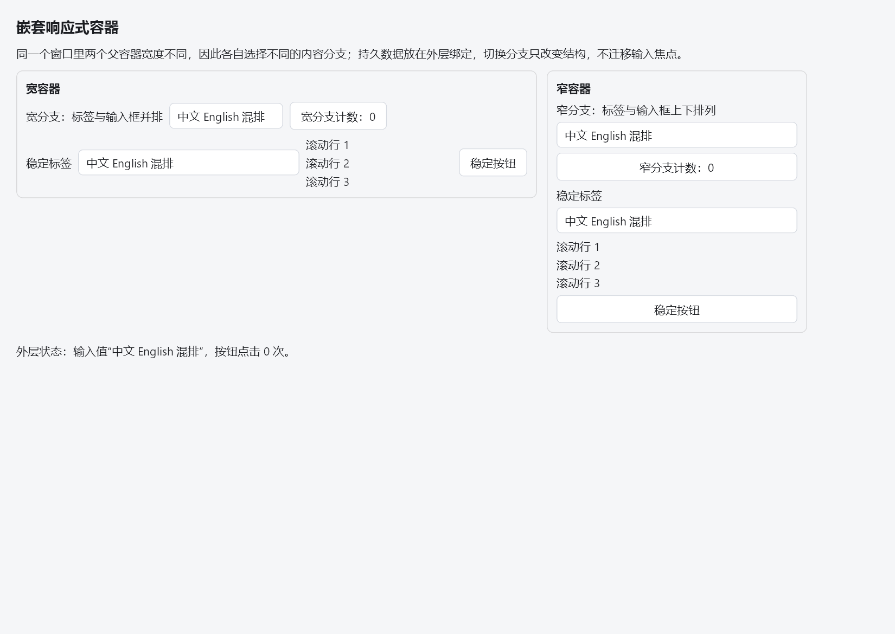

# 通用响应式布局交付记录（RL-09）

记录日期：2026-10-16

状态：**已完成，Codex 复审通过**（2026-10-16；九项任务均已完成，验证范围和未验证平台见下文）

设计依据：[响应式布局计划](../plan/2026-10-16-responsive-layout-plan.md)、[当前任务索引](../task/README.md)、[RL-01…RL-08 审核记录](../return/2026-10-16-responsive-layout-review.md)。

执行环境：Windows 11 桌面、.NET SDK 10.0.303、真实 SkiaSharp/HarfBuzz、OpenGL 3.3（Intel RaptorLake-S Mobile Graphics Controller）、系统 DPI 150%（未修改系统 DPI 设置）。

## 1. 交付范围与五项能力

RL-01…RL-08 已分别通过 Codex 复审；本记录汇总最终集成验收结果，未改动生产代码（RL-09 只新增验证程序与文档）。

| 能力 | 公开 API | 通用实现位置 | 使用与迁移指南 |
|---|---|---|---|
| 弹性空间分配 | `.Flex(...)`、`.FillWidth()`、`FlexAxis` | `src/CSharp.UI/Views/Flex.cs` | [响应式布局 §2](../guide/responsive-layout.md) |
| 自动换行 | `Flow`、`.Spacing`、`.LineSpacing`、`.Align` | `src/CSharp.UI/Views/Flow.cs` | [响应式布局 §3](../guide/responsive-layout.md) |
| 稳定布局切换 | `AdaptiveStack`、`.VerticalSpacing`、`.WideAlign` | `src/CSharp.UI/Views/AdaptiveStack.cs` | [响应式布局 §4](../guide/responsive-layout.md) |
| 容器宽度响应 | `Responsive`、`ResponsiveInfo` | `src/CSharp.UI/Views/Responsive.cs` | [响应式布局 §5](../guide/responsive-layout.md) |
| 示例与验证 | `GalleryApp`、`NestedResponsiveExample`、四套测试与独立探针 | `samples/`、`tests/` | [响应式布局 §7](../guide/responsive-layout.md) |

五项能力都在通用 API 层实现，示例只作为调用方；`NestedResponsiveExample` 可独立实例化（见 §7 证据）。

## 2. 构建、测试与回归数量

全部命令顺序执行，共享工程不并行构建。

| 命令 | 退出码 | 结果 |
|---|:--:|---|
| `dotnet build CSharp.UI.slnx --no-restore -m:1 -nodeReuse:false` | 0 | 0 错误、12 条既有 xUnit 分析器警告 |
| `dotnet build CSharp.UI.slnx -c Release --no-restore -m:1 -nodeReuse:false` | 0 | 0 错误、12 条既有警告 |
| `dotnet run --project tests/CSharp.UI.Tests --no-build` | 0 | 300 通过 / 0 失败 / 0 跳过 |
| `dotnet run --project tests/CSharp.UI.Text.Tests --no-build` | 0 | 67 通过 / 0 失败 / 0 跳过 |
| `dotnet run --project tests/CSharp.UI.Integration.Tests --no-build` | 0 | 30 通过 / 0 失败 / 0 跳过 |
| `dotnet run --project tests/CSharp.UI.OpenTK.Tests --no-build` | 0 | 242 通过 / 0 失败 / 0 跳过 |
| 合计 | 0 | **639 通过 / 0 失败 / 0 跳过** |

- 441 基线（首版验收：核心 172 + 文本 67 + 集成 14 + OpenTK 188）全部保留，且四个工程当前数量均不低于基线；相对 441 净增 198（核心 +128、集成 +16、OpenTK +54）。
- 未弱化任何旧断言：R16 文字像素映射、R17 颜色遮罩、R18 窗口回调/生命周期回归全部保持通过。
- 关键无回归子集（按类单独运行，均退出码 0）：`GalleryIdleAndBoundsTests` 5、`TextureEvictionRegressionTests` 2、`GalleryHostResizeTests` 1、`TextColorMaskTests` 15、`TextRasterSamplingTests` 6、`WindowResizeRedrawTests` 10，合计 39。

## 3. 三个示例的 Debug/Release 与 DLL 副本一致性

- `samples/CSharp.UI.Samples.Counter`、`…TodoList`、`…ControlGallery` 的 Debug 与 Release 均由最终解决方案构建更新。
- 18 份副本哈希逐一比对通过（3 示例 × 2 配置 × `CSharp.UI`/`CSharp.UI.Text`/`CSharp.UI.OpenTK`），0 不一致：

| 配置 | `CSharp.UI.dll` | `CSharp.UI.Text.dll` | `CSharp.UI.OpenTK.dll` |
|---|---|---|---|
| Debug | `B6C9FD28…EA0554` | `7A80DD2F…0DADD3` | `CC1C64D6…869DCF` |
| Release | `44076850…353F06` | `4897A73E…C005728` | `BD126B53…F1DEF71` |

## 4. Release 启动冒烟（5 帧，按现有 `CSHARPUI_SMOKE_FRAMES` 约定）

`CSHARPUI_SMOKE_FRAMES=5` 直接运行 Release 产物，三个示例均在打印窗口/DPI/GL 信息后 `RequestExit(0)`，无窗口或进程遗留。

| 示例 | 退出码 | 逻辑视口 | framebuffer | DPI |
|---|:--:|---|---|---|
| ControlGallery | 0 | 900×700 | 1350×1050 | 1.5 |
| Counter | 0 | 480×320 | 720×480 | 1.5 |
| TodoList | 0 | 760×480 | 1140×720 | 1.5 |

## 5. Windows 150% 逻辑/物理尺寸、输入与跨断点缩放

- 本机系统缩放为 150%：以上冒烟、截图与原生循环中 `PixelScale` 恒为 1.5，物理尺寸 = 逻辑尺寸 × 1.5，且 `context.FramebufferSize`、渲染器 framebuffer 与 GLFW 实际 framebuffer 三方一致（原生循环 `geometryErrors=0`）。
- 输入在 DPI 1/1.25/1.5/2 下由自动化回归覆盖：`DpiInputTests`、`GalleryBreakpointInputTests`（含 Slider Down/Move 不同坐标、拖动中跨断点捕获、中文输入与选区、双层滚轮）随 242 项 OpenTK 套件通过；Codex 独立输入探针本次重跑 180/180 通过、退出码 0（四档 DPI 连续 1024→320→768→480→1024→320）。
- 跨断点缩放程序化验证：`GalleryHostResizeTests`（7 档 300/520/620/900/1120/340/820，每步提交完整帧、`pending=0`）通过；原生模态循环见 §6。
- **明确区分**：以上是程序化 `ClientSize`/API 派发与真实宿主回调；真实人工鼠标拖拽**未验证**，本记录不声称人工验证通过。

## 6. 真实 GalleryApp / Nested 的原生 SC_SIZE 模态循环

独立探针 `artifacts/responsive-work/rl09-native-scsize`（真实 `OpenTkHost` + 真实 Skia + 真实 GL，`PostMessage(WM_SYSCOMMAND, SC_SIZE)` 进入真实尺寸调整模态循环；捕获 `WM_ENTERSIZEMOVE/WM_EXITSIZEMOVE`；**强制要求 front buffer 可读且逐宽度非零像素采样**，空采样判为失败）。

- Gallery（跨 560/840 断点变宽/缩窄：900→500→1120→420→620→300→1024）：
  `enters=1, exits=1, modalFrames=20, geometryErrors=0, frontReadable=True`；
  7 个逻辑宽度全部观测到，逐宽度采样 472,500–1,764,000 像素、背景与内容像素均 >0、纯黑像素 0、右侧边缘非背景像素 0；
  自适应模式计数随断点翻转（900/1120/1024 → 4–5 个横向；620 → 1；500/420/300 → 0）；
  每个宽度的逐节点布局签名与同逻辑宽度、同 DPI 的无窗口真实布局完全一致。
- Nested（1100→1200→700→500→900→300）：`enters=1, exits=1, modalFrames=16, geometryErrors=0`，6 个宽度采样全部非零、无黑边，签名一致。
- **明确区分**：这是真实 Windows 原生模态循环内的**自动**变宽/缩窄（`SetWindowPos` + `InvalidateRect`），不是人工鼠标拖动边框；物理鼠标人工验证仍未做。
- 旧的 `artifacts/resize-native-review`（只运行简单 `Text`，且最终判定未强制 `frontReadable`/`expandedPixels>0`）仅作为旧保护回归，不作为本轮证据。

## 7. 原尺寸截图与独立嵌套示例证据

`artifacts/responsive-work/rl09-capture` 从真实窗口 front buffer 读取全帧并原尺寸写出 PNG（1 纹素 = 1 物理像素），文件名含逻辑/物理尺寸与 DPI。
五张 PNG 已按原字节复制（未重采样、未编辑）到本目录下的证据目录 [2026-10-16-responsive-layout-evidence](2026-10-16-responsive-layout-evidence)，随仓库提交分发。

| 文件（点击查看原尺寸） | 逻辑 | 物理（原尺寸） | 断点模式 | wrapFrame / 分支 |
|---|---|---|---|---|
| [control-gallery-logical1024x700-physical1536x1050-dpi1.5.png](2026-10-16-responsive-layout-evidence/control-gallery-logical1024x700-physical1536x1050-dpi1.5.png) | 1024×700 | 1536×1050 | 5/5 横向 | Frame 358.477、排版 358.477×37.242 |
| [control-gallery-logical320x700-physical480x1050-dpi1.5.png](2026-10-16-responsive-layout-evidence/control-gallery-logical320x700-physical480x1050-dpi1.5.png) | 320×700 | 480×1050 | 0/5 横向 | Frame 252、排版 252×55.863（3 行） |
| [nested-responsive-logical1100x780-physical1650x1170-dpi1.5.png](2026-10-16-responsive-layout-evidence/nested-responsive-logical1100x780-physical1650x1170-dpi1.5.png) | 1100×780 | 1650×1170 | [H,V] | 面板 616/296，分支 `HStack(3)` / `VStack(3)` |
| [nested-responsive-logical700x780-physical1050x1170-dpi1.5.png](2026-10-16-responsive-layout-evidence/nested-responsive-logical700x780-physical1050x1170-dpi1.5.png) | 700×780 | 1050×1170 | [H,V] | 面板 616/296，分支 `HStack(3)` / `VStack(3)` |
| [nested-responsive-logical500x780-physical750x1170-dpi1.5.png](2026-10-16-responsive-layout-evidence/nested-responsive-logical500x780-physical750x1170-dpi1.5.png) | 500×780 | 750×1170 | [V,V] | 面板 436/296，分支 `VStack(3)` / `VStack(3)` |

宽/窄 Gallery 与同一窗口内两种嵌套分支的预览：

五张 PNG 均为非空内容（非背景像素 82,275–247,433），纯黑像素 0；两次运行哈希一致（渲染确定性）。SHA256 与原始输出见 `artifacts/responsive-work/rl09-progress.txt`、`artifacts/responsive-work/rl09-evidence`。

## 8. 平台范围与未验证边界（如实记录，不以估计代替）

| 范围 | Windows（本机） | macOS / Linux |
|---|---|---|
| Debug/Release 解决方案构建 | 已验证（退出码 0） | 未验证（RL-09 未做 RID 交叉编译：本机 `dotnet restore -r linux-x64` 离线失败，退出码 1，故连编译也未声称通过） |
| 核心/文本/集成测试（CPU） | 已验证 300+67+30 | 未执行（代码为平台无关逻辑，但未在真机运行） |
| 离屏 GL 图形测试 | 已验证 242 项 OpenTK 套件 | 未执行（无真机 GL 上下文） |
| 原生窗口 / SC_SIZE 模态循环 | 已验证（Gallery/Nested） | 未执行 |
| 真实输入（程序化派发） | 已验证（DPI 1/1.25/1.5/2） | 未执行 |
| 真实人工鼠标拖拽 | 未验证 | 未验证 |
| LCD/ClearType、系统 DPI 修改 | 未验证 / 未修改 | 未验证 |

未验证范围不代表通过，也不以“非黑帧”“计划”“示例可用”替代通用能力与真机结论。

## 9. 审核问题闭环与文档一致性

- RL-01…RL-08 的每一项实施期问题均已在 [审核记录](../return/2026-10-16-responsive-layout-review.md) 中记录为关闭；本轮未发现需要修改生产代码的新问题。
- **Codex 独立验收（RL-09 实施期间，记录于审核记录末端）**：独立 SHA256 核对三示例 × 两配置 × 三库共 18 份 DLL，18/18 匹配（`final-dll-independent.json`）；独立执行四套 **Release** 程序集 300+67+30+242=639，全部失败/错误/跳过 0、退出码 0（`final-release-*-independent.txt`），覆盖最终优化产物而非仅 Debug；核对三个 Release 示例实际 5 帧 smoke 全部退出码 0 且 DPI 1.5；独立查看本轮原尺寸宽/窄 Gallery 与 Nested PNG，视觉与日志一致、未见黑区。
- 本地重跑 Codex 独立探针：`input-invariants` 180/180、退出码 0；`gpu-invariants` 16/16、退出码 0（同一 Gallery 运行时四宽 × 四 DPI，最终 RGB 与直接绘制参考 mean 0.0585–0.0992、max 2）。
- Codex 实施期截图探针预审（等待稳定帧时宿主按需绘制、不保证后续帧）已处理：`rl09-capture` 在等待目标宽度与稳定帧、以及缩放后均显式调用 `context.RequestRedraw()`，不依赖偶发系统刷新；两模式重跑仍退出码 0、PNG 哈希不变，生产宿主未改动。
- Codex 交付文档预审（截图需随仓库分发）已处理：五张原尺寸 PNG 按原字节复制到 [证据目录](2026-10-16-responsive-layout-evidence) 并在 §7 提供可点击链接与预览，未重采样或编辑图像。
- 文档检查：`node artifacts/responsive-work/audit-docs.mjs` 最终检查 51 个 Markdown 文件、285 条相对链接与 9 任务/10 依赖边，errors 为空；`validate-docs.mjs` 校验 27 个 UTF-8 文件、链接、代码围栏与依赖图通过。
- API 指南代码与实际签名核对通过（`FrameView`/`Frame` 范围重载、`.Flex`、`.FillWidth`、`Flow`、`AdaptiveStack`、`Responsive`、`ResponsiveInfo` 只读属性）。
- 已修正 `docs/guide/testing.md` 中过时的运行器过滤器写法（`--filter-class`/`--filter-method` → 实际支持的 `-class`/`-method`/`-trait`）。

## 10. 证据与提交

- 随仓库分发的图像证据：[2026-10-16-responsive-layout-evidence](2026-10-16-responsive-layout-evidence)（五张原尺寸 PNG，与 `artifacts/responsive-work/rl09-evidence` 逐字节一致）。
- 过程与原始输出：`artifacts/responsive-work/rl09-progress.txt`、`rl09-debug-build.txt`、`rl09-release-build.txt`、`rl09-CSharp.UI.*.txt`、`rl09-release-smoke.txt`、`rl09-native-scsize-gallery.txt`、`rl09-native-scsize-nested.txt`、`rl09-capture-*.txt`、`rl09-input-invariants-rerun.txt`、`rl09-gpu-invariants-rerun.txt`、`rl09-evidence/*.png`（在 `.gitignore` 覆盖的 `artifacts/` 下，仅本地保留；需要分发的图像已复制到上方证据目录）。
- 记录提交：先以 `e66bbcd`（`Add RL-09 responsive layout final acceptance and delivery record`）提交交付文档，再按 Codex 预审补交图像证据与本次修订；未 amend、未推送；未改动用户 `AGENTS.md`、Codex `docs/return` 与任何系统/SDK/NuGet 配置。完整 SHA 与精确文件清单见 `artifacts/responsive-work/rl09-progress.txt` 与交付回复。
- 完成判定：Codex 已于 2026-10-16 完成复审，九项任务与索引均标记完成。实现提交 `e66bbcd`、原尺寸证据提交 `faca6ba`；最终独立审核结论见上述审核记录。

## 11. Codex 最终独立验收

2026-10-16：复审通过。独立Release四套300+67+30+242=639项全部通过、18份DLL SHA256全部匹配；核对Debug完整639项、三示例5帧smoke、原生Gallery/Nested非零像素采样与稳定布局，检查宽窄和嵌套原尺寸图像，5张持久PNG与原始输出哈希一致。独立输入180项和GPU16项通过。文档、相对链接、任务依赖图与UTF-8检查通过。审核中发现的问题全部闭环；未验证平台和人工边界保持第8节所列，不扩展本次通过结论。
